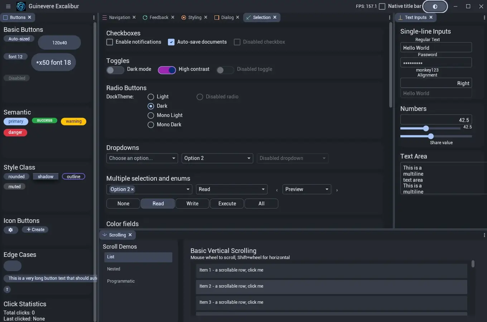

# Guinevere.Excalibur

A ready-to-use set of default controls for the [Guinevere](https://github.com/MASS4ORG/Guinevere)
immediate-mode GUI library. Everything here is an extension method on `Gui` living in the `Guinevere`
namespace, so it drops into an existing Guinevere app with a single package reference and no setup.



The optional [TextEditor](../Guinevere.Excalibur.TextEditor/README.md) package adds syntax highlighting, multiple carets, folding, find and replace, completion and diagnostics.

## Install

```
dotnet add package MASS4.Guinevere.Excalibur
```

## Quick Start

```csharp
using Guinevere;

public partial class App
{
    private bool _isEnabled = true;
    private string _name = "";
    private float _volume = 0.5f;
    private int _activeTab;

    public void Draw(Gui gui)
    {
        if (gui.Button("Run")) { /* clicked */ }
        gui.Checkbox(ref _isEnabled, "Enable feature");
        gui.TextInput(ref _name, "Your name");
        gui.Slider(ref _volume, 0f, 1f);

        gui.Tabs(ref _activeTab, tabs =>
        {
            tabs.Tab("Home", () => gui.DrawText("Home content", 12, Color.Gray));
            tabs.Tab("Settings", () => gui.DrawText("Settings content", 12, Color.Gray));
        });
    }
}
```

## Controls

| Group | APIs | Purpose |
|-------|------|---------|
| Actions | `Button`, `ImageButton` | Pointer and keyboard-activated buttons with focus feedback. |
| Selection | `Checkbox`, `Toggle`, `RadioButton`, `RadioGroup`, `Dropdown`, `MultiDropdown`, `EnumDropdown` | Boolean, exclusive, list and flag selection, with searchable multi-selection and enum presentations. |
| Text and values | `TextInput`, `PasswordInput`, `TextArea`, `NumberField`, `Slider`, `ObjectField` | Text editing, scrub editing, numeric ranges, and compact object fields. |
| Display | `Image`, `ProgressBar`, `WrappedText`, `Toast`, `Toasts`, `ClearToasts` | Images, progress, wrapping, and transient notifications. |
| Navigation | `Tabs`, `TabBar`, `TabStrip`, `PillTabs`, `VerticalTabs`, `Breadcrumb`, `TreeView`, `FileBrowser` | Tabs, trails, virtualised trees, and an embeddable filesystem picker. Tabs are closable only with `closable: true`. |
| Data | `Table` | A virtualised table over a counted, indexed data source, with a sticky header, custom cell renderers and empty and loading states. |
| Menus and overlays | `AppBar`, `MenuBar`, `Flyout`, `CascadeMenu`, `ContextMenu`, `Popup`, `ModalPopup`, `Dialog`, `Tooltip` | Application chrome, command menus, popovers, modal windows, and delayed help. |
| Layout tools | `Splitter`, `DockSpace`, `DockLayout` | Resizable panes and persistent split/tab/float docking. |

## Styling

Controls take no colors or radii; their look comes from `.pss` stylesheets. Excalibur ships a default base (`ExcaliburStyles.DefaultSheet`); the selected base is kept under every application sheet, so a theme overrides any token or rule in it. Restyle with classes, sheets, or tokens for a subtree:

```csharp
gui.StyleSheets.Add(StyleSheet.Parse("""
    $accent = #88c0d0;
    button.danger { background-color = #dc3545; color = #ffffff; :hover { background-color = #c82131; } }
    """));

if (gui.Button("Delete", classes: ["danger"])) Delete();

using (gui.Node().Enter())
{
    gui.SetStyleToken("surface", Color.FromArgb(255, 40, 44, 52)); // this subtree only
    gui.Button("Dark");
}
```

`ExcaliburStyles.DefaultSheetText` is a starting point for a full theme.

### Selecting a base

Select a complete base independently for each `Gui` before building controls. `Ensure`, control rendering and token reads preserve this selection, including when the selected sheet is removed or moved in `gui.StyleSheets`.

```csharp
var brand = StyleSheet.Parse(File.ReadAllText("brand.pss"));
var errors = ExcaliburStyles.ValidateBaseSheet(brand);
ExcaliburStyles.SetBaseSheet(gui, brand); // throws ArgumentException if the base is incomplete
var selected = ExcaliburStyles.GetBaseSheet(gui);

ExcaliburStyles.SetTheme(gui, ExcaliburStyles.Light); // color overlay above the selected base
ExcaliburStyles.SetTheme(gui, null);                 // remove the color overlay
ExcaliburStyles.SetBaseSheet(gui, null);             // restore the shipped base
```

Sheet order is selected base → color overlay → application sheets in their existing relative order. Selector specificity still wins across sheets; later sheets break specificity ties. Host tokens, inherited tokens and scoped tokens supply overrides. Base changes preserve the color overlay and application sheets. Repeated selection is a no-op when the base is already first. Resetting the base preserves the overlay; `SetTheme(null)` and `SetTheme(Dark)` remove the overlay and expose the selected base. Passing the selected base to `SetTheme` adds no duplicate layer; selecting a complete sheet already used as an overlay promotes it to the base.

The replacement must supply its own fallbacks: all 24 color tokens listed below and a nonnegative pixel `$radius`. Tokens must evaluate to their required types in the replacement alone, including its imports; overlays, host tokens and application sheets cannot make an incomplete base valid. Missing references, cycles and wrong token types are reported by `ValidateBaseSheet`; `SetBaseSheet` rejects an incomplete sheet before changing GUI state. No shipped appearance rules are silently inserted behind a replacement.

Essential control declarations are checked by resolving representative elements and parts against the replacement. Grouped rules, universal selectors and stylesheet inheritance are supported; a replacement can share common rules and needs no copy of the shipped selector structure. Required declarations must be present and have no unresolved token references. Background requirements also accept `background`, including gradients, except for the `form` and `checker` contracts whose painters read `background-color` directly. The minimum contract is:

| Elements or parts | Required declarations |
|---|---|
| Buttons, choice rows, inputs, dropdowns, sliders, trees, breadcrumbs and labels | `color` |
| Button/input/dropdown surfaces, chips, lists, progress, tab bars/panels, docking surfaces and feedback, menus, popups/dialogs/toasts/tooltips, application bars, overlays, scrollbars, object fields and file panels | `background-color` or `background` |
| Tab rows/navigation, menu text, tree expanders/ghosts, popup/dialog titles and close buttons, breadcrumb crumbs/separators, object pick/clear buttons, file text/rows/places/columns/details, input placeholders and color-channel labels | `color` |
| Choice indicators, radio checked dots, toggle tracks/thumbs, input selection, slider parts, progress fill, tab markers, breadcrumb underline, window glyph fill and scrollbar thumb | `background-color` or `background` |
| Selected option/tree rows and each toast severity's accent | `background-color` or `background` |
| Option indicators, color areas/strips, swatches, previews and file lists | `border-color` |
| File headers; dialog footers | `border-bottom-color`; `border-top-color` respectively |
| Color-area cursors and color-strip thumbs | `width`, `height`, `border-color` |
| Checkerboard | `background-color`, `color` |
| Color picker, picker rows, swatches, hex fields, channel groups/rows and color fields | `flex-direction` |
| Slider track and progress | `height` |
| Slider thumb | `width`, `height` |
| Horizontal/vertical splitter | `width`/`height` respectively, `cursor` |
| Toast accent | `width` |
| Autoformers `form` | `color`, `dim-color`, `background-color`, `border-color`, `accent-color`, `divider-color`, `negative-color`, `base-background`, `border-radius` |

Borders, radii, spacing, fonts, interaction feedback and other optional visuals remain choices of the base author. Validation checks completeness, while the control contracts below describe the properties and states available for designing the appearance. Test contrast, keyboard focus, disabled states and layouts when authoring a base.

Material 3, neutral and platform-specific bases are separate future design choices. A Material 3 base needs its own state, elevation and shape rules; a neutral base can share compact rules across control families; platform-specific bases need separate authored sheets and platform selection by the application. `FollowSystemAppearance` selects color overlays and accent tokens, so it does not select a platform base. The shipped dark appearance remains the default; a future default switch requires an explicit compatibility decision and migration instructions.

### Themes

A color theme is a token-only sheet layered right above the selected base. Excalibur ships `Light`, `MonoLight` and `MonoDark`; any sheet of `$token = value;` declarations works the same way. `ExcaliburStyles.Dark` aliases the shipped default sheet and removes the color overlay. Application sheets added with `gui.StyleSheets.Add` still override the theme.

```csharp
ExcaliburStyles.SetTheme(gui, ExcaliburStyles.Light); // replaces the previous overlay; Dark or null removes it
var ink = ExcaliburStyles.TokenColor(gui, "text");    // theme colors for an application's own drawing
gui.DrawDropIndicator(drop.State, style: ExcaliburStyles.DroppableArea(gui));
```

`ControlPalette` and `gui.ControlPalette` are gone, and so are the color tokens of `gui.ControlStyle` (dimensions stay). To migrate:

| Before | After |
|---|---|
| the default light palette | `ExcaliburStyles.SetTheme(gui, ExcaliburStyles.Light)`; the default is now dark |
| `new Gui { ControlPalette = ControlPalette.Dark }` | nothing: dark is the default |
| a custom `new ControlPalette { Surface = … }` | a sheet of `$surface = …;` tokens passed to `SetTheme`, or `gui.StyleSheets.SetToken("surface", …)` |
| `gui.ControlPalette.Text`, `gui.ControlStyle.Text` | `ExcaliburStyles.TokenColor(gui, "text")` |
| `ControlStyles.Value<ControlAccent, Color>(c)` on a subtree | `gui.SetStyleToken("accent", c)` |
| `gui.ApplyControlPalette()` with a `control-palette { … }` rule | top-level `$token = value;` declarations in the sheet |

Token names are the palette's property names in kebab case (`SurfaceHover` → `surface-hover`).

### Contracts

| Control | Element | Classes | States and modifiers | Properties read |
|---|---|---|---|---|
| `Button` | `button` | caller classes; `primary` in the default sheet | `:hover`, `:active`, `:focus`, `:disabled` | `background-color`/`background`, `border-*`, `border-radius`, `padding` (fit size), `color`, `font-*`, `outline`, `box-shadow`, `opacity`, `cursor` |
| `Button(icon)` | `button` | `icon` + caller classes | as `Button`, plus `:checked` (pass `checked` as a class) | as `Button` |
| `ImageButton` | `button` | `image` + caller classes | as `Button`; the images swap by state | as `Button`; the image is drawn under the border and outline |
| `Checkbox` | `checkbox`, drawn child `indicator` | caller classes and `id` | `:hover`, `:active`, `:focus`, `:disabled`, `:checked`, `:mixed` | row `color`/`cursor`; indicator background, border, radius and color; focus `outline`; root box/text properties |
| `RadioButton` | `radio`, drawn children `indicator`, `dot` | caller classes and `id` | `:hover`, `:active`, `:focus`, `:disabled`, `:checked` | as `Checkbox`; `dot` background/border/radius |
| `Toggle` | `toggle`, drawn children `track`, `thumb` | caller classes and `id` | `:hover`, `:focus`, `:disabled`, `:checked` | as `Checkbox`; track background/radius; thumb background/border/radius |
| `TextInput`/`PasswordInput`/`TextArea`/`NumberField` | `input` | `password`, `area`, `number` respectively, plus caller classes and `id` | `:hover`, `:active`, `:focus`, `:disabled` | root box/text/font properties and `cursor`; child `placeholder` color (`:disabled`), child `selection` background |
| `Dropdown` | `dropdown`, popup children `listbox`, `option` | caller classes and `id` | button `:open`, `:disabled`; option `:hover`, `:highlighted`, `:selected` | root box/text properties and `cursor`; listbox background/border/radius; option background/radius and `cursor` |
| `MultiDropdown` | `dropdown`, children `chip`, `listbox`, `option`, `indicator` | caller classes and `id` | button `:open`, `:disabled`; chip `:hover`; option `:selected`, `:highlighted`; indicator `:checked`, `:mixed` | as `Dropdown`, plus chip background/radius/color and indicator border/radius |
| `EnumDropdown` | `dropdown`; `button.segment` with `EnumPresentation.ToggleButtons` | `segment` (toggle buttons) plus caller classes | segment `:checked` | as `Dropdown`/`Button` |
| `Slider` | `slider`, drawn children `track`, `fill`, `thumb` | caller classes and `id` on `slider` | `:hover`, `:active`, `:focus`, `:disabled`; `thumb:focus` | root box/text properties, `gap`, `flex-direction`, `align-items`; track `height`; thumb `width`, `height`, `max-width`, `max-height`; each part's background, border, radius, outline, shadow and opacity |
| `ProgressBar` | `progress`, drawn child `fill` | caller classes and `id` on `progress` | `:indeterminate` when the fraction is null | root `width`, `height`, `padding` and box properties; fill background, border, radius, outline, shadow and opacity |
| `Splitter` | `splitter` | caller classes and `id` | `:horizontal`, `:vertical`, `:hover`, `:active` while captured | axis size, background, border, radius, outline, shadow, opacity and cursor |
| `Tabs`/`PillTabs`/`VerticalTabs` | `tabs`, `tabbar`, `tab`, `tabpanel`, `tab-close`, `tab-nav` | `plain`, `pill`, `vertical` plus caller classes | tab `:hover`, `:selected`, `:focus`, `:disabled`; `tab-nav` `:hover`, `:disabled`; `tab-close` `:hover` | tabbar background/border/radius; tab color/background/radius/outline; tabpanel background/border/radius; close radius/color; nav color |
| `TabStrip` | `tabstrip`, `tab`, `marker`, `tab-close` | caller classes and `id` | tab `:hover`, `:selected`; `tab-close` `:hover` | tabstrip background; tab background/color; marker background; close radius |
| `DockSpace`/`DockLayout` | `dockspace`, `dock-panel`, `dock-window`, `dock-grip`, `dock-empty`, `dock-ghost`, `dock-icon`, `drop-indicator`, `drop-preview` | `dock` on floating windows | — | background, border, radius, color and cursor per element; tab icon `width`; dock splitter thickness through `splitter.dock` |
| `TreeView` | `treeview`, `tree-row`, `tree-expander`, `tree-icon`, `tree-ghost` | caller classes and `id` | row `:hover`, `:selected`; expander `:hover` | treeview color and font-size; row background/radius, `height`, `indent`, `inset`; expander color and width; icon width; ghost background/radius/color |
| `Table` | `table`, `table-header`, `table-header-cell`, `table-body`, `table-row`, `table-cell`, `table-empty`, `table-loading` | caller classes and `id` on `table` | header cell `:sorted`, `:sorted-more`, `:sorted-secondary`, `:ascending`, `:descending`; row `:odd`, `:hover` | table color; header background/border; header cell color; row background/border; empty and loading color |
| scrollbar | `scrollbar`, child `thumb` (drawn by the styling package) | — | thumb `:hover`, `:active` | scrollbar background; thumb background/radius |
| `Popup` | `popup`, `popup-content`, `popup-title`, `overlay` | caller classes and `id` | `:closed` while hidden | popup background/border/radius; title background/color; overlay background |
| `Dialog` | `dialog`, `dialog-title`, `dialog-content`, `dialog-footer`, `dialog-close` | caller classes and `id` | `:closed`; close `:hover` | dialog background/border/radius; title/color; footer border; close radius/color |
| `Tooltip` | `tooltip` | caller classes and `id` | `:closed` | background/border/radius/color |
| `Toast` | `toast`, drawn child `accent` | `info`, `positive`, `warning`, `negative` plus caller classes | — | toast background/border/radius/color; accent width/background |
| `MenuBar`/`Flyout`/`ContextMenu` | `menubar`, `menu`, `menu-title`, `menu-item`, `menu-shortcut`, `menu-separator`, `menu-expander`, `menu-check` | caller classes | `:hover`, `:focus`, `:open`, `:highlighted`, `:disabled` | background/border/radius/color; item background/radius/outline; shortcut and separator color |
| `AppBar` | `appbar`, `window-button`, `glyph-fill` | — | `window-button` `:hover` | appbar background/color/height (default 36); window-button background; glyph-fill background |
| `Breadcrumb` | `breadcrumb`, `crumb`, `underline`, `crumb-separator` | crumb `link`/`current` classes | `:link:hover`, `:link:active`; separator `:hover`, `:open` | crumb color and underline; separator color |
| `Label`/`WrappedText` | `label`, `wrapped-label` | caller classes and `id` | — | `color`, `font-*` |
| `ObjectField` | `object-field`, `drop-outline`, `object-pick`, `object-clear` | caller classes and `id` | `:hover`, `:empty`, `:accepting`, `:rejecting`; drop-outline `:accepted` | background/border/radius/color; pick and clear color |
| `FileDialog` | `file-browser`, `file-sidebar`, `file-list`, `file-header`, `file-column`, `file-row`, `file-place`, `file-label`, `file-status`, `file-detail` | `primary` on the accept button | row/place/column `:hover`, `:selected` | background, border, radius and color per element |
| Autoformers form | `form` | — | — | `color`, `dim-color`, `background-color`, `border-color`, `accent-color`, `divider-color`, `negative-color`, `base-background`, `border-radius` |

The embedded default sheet (`Styles/guinevere.default.pss`, exposed as `ExcaliburStyles.DefaultSheetText`) is the normative list of selectors and of the properties each one reads; the table above summarises it. Drawn parts support direct-child selectors such as `slider#volume > thumb` and inherit tokens from their control. Slider track height and thumb dimensions accept pixels or percentages of the track viewport's height. `Slider` value labels use the stylesheet font size unless `fontSize` is supplied. `ProgressBar` defaults to the sheet's height and fills its parent; `Splitter` defaults to the sheet's axis size. Explicit dimensions override sheet dimensions.

```pss
slider.volume > track { height = 8; border-radius = 4; }
slider.volume > thumb { width = 18; height = 18; border-radius = 50%; }
slider.volume:focus > thumb { outline = 2px solid $accent; outline-offset = 3; }
progress.download > fill { background = linear-gradient(to right, #5081d9, #88c0d0); }
splitter:horizontal { width = 8; cursor = col-resize; }
```

When upgrading, move slider/progress colors and splitter colors into the matching rules, and pass `classes` or `id` to select them. `Slider.fontSize`, `ProgressBar.height` and `Splitter.thickness` are nullable so omitted values follow the sheet; recompile callers against the updated API. Applications with positional compiler call-site arguments should use named `filePath` and `lineNumber` arguments.

Default tokens: `$base-background`, `$surface`, `$surface-hover`, `$surface-active`, `$popup`, `$border`, `$border-active`, `$divider`, `$accent`, `$accent-hover`, `$accent-subtle`, `$text`, `$text-dim`, `$text-disabled`, `$text-on-accent`, `$selected`, `$positive`, `$negative`, `$warning`, `$info`, `$focus-ring`, `$shadow`, `$overlay`, `$text-selection`, `$radius`. Every Excalibur control now draws from sheets, including the Autoformers `form` contract.

## Buttons and selection

`Button(icon.Labeled("Readable action name"))` accepts a core `Icon` containing a glyph, image or vector picture, and an icon-only button is a field-height square with the `icon` class. Tintable pictures follow the button's PSS text color without depending on a particular icon font. The readable name is published to the control semantics sink. Menu titles/items also publish labels and checked/disabled state; dropdowns publish their label, value and open state and support Enter/Space, Up/Down, Home/End and Escape from the keyboard.

```csharp
if (gui.Button("Build")) Build();
gui.Checkbox(ref _enabled, "Enable feature");
gui.Toggle(ref _darkMode, "Dark mode");
gui.RadioGroup(ref _quality, [(0, "Low"), (1, "Medium"), (2, "High")]);
gui.Dropdown(["Draft", "Review", "Published"], ref _status);
```

Buttons and dropdowns receive mouse focus; use Tab to move through controls and Enter or Space to
activate buttons. Open popovers and dialogs constrain Tab to their visible controls.

## Searchable selection

Keep selection in your application and call the widget from the same site in both GUI passes:

```csharp
// Fields kept between frames:
private readonly string[] _tags = ["Gameplay", "UI", "Audio"];
private IReadOnlyList<string> _selectedTags = [];

// Inside Draw(Gui gui):
gui.MultiDropdown(_tags, _selectedTags, out var result, chips: true,
    comparer: StringComparer.Ordinal).Width(240);
if (result.Changed) _selectedTags = result.Selected;
```

Search uses case-insensitive substring matching. Select all and Clear affect only filtered options; other selected values stay intact. Equality defaults to `EqualityComparer<T>.Default`, duplicate options show once, and returned values follow option order before unknown values in their original order. The summary shows up to two labels or a count; `chips: true` shows up to two removable chips and a remaining count. Rows are virtualized; `maxVisibleItems` defaults to six. Filtering still scans the options.

Use Up/Down to move through results and Enter to select; Space toggles while the list is focused and types a space in search. Home/End and PageUp/PageDown navigate the focused list. Tab stays within the popup, and Escape or an outside click closes it. Set `enabled: false` to disable interaction. Give repeated widgets distinct node scopes or `filePath` identities.

```csharp
gui.EnumDropdown(ref _permissions); // [Flags] automatically uses checkboxes.
gui.EnumDropdown(ref _mode, EnumPresentation.ToggleButtons);
gui.EnumDropdown(ref _mode, EnumPresentation.Paging);
```

Ordinary enums select one value. Flag edits add/remove only the chosen bits; selecting zero (None) clears the whole value. A None option is supplied when a flags enum has no declared zero. Paging wraps through distinct declared values in `Enum.GetValues` order, including sparse values; for flags it replaces the entire mask. Button groups occupy one horizontal row: use the dropdown for many or long labels. Pass `display` to provide custom labels.

`EnumDropdown(ref value)` returns its node, which reports `Changed` (and converts to `true`) in the render pass of the frame an edit is delivered. `MultiDropdownResult<T>.Changed` and enum edits are delivered once in the build pass, so persistence/undo can run inside that condition. For custom multi-object drawers, apply `result.Changes` to each owner and use `mixed`/`isMixed` for feedback. The runtime `EnumDropdown(Enum, out current, out changes, ...)` overload and `EnumSelection.Apply` support enum drawers. Autoformers.Excalibur handles this automatically;

## Text and numeric input

```csharp
gui.TextInput(ref _name, placeholder: "Project name");
gui.TextArea(ref _notes).Width(420).Height(120);
gui.NumberField(ref _opacity, min: 0, max: 1, step: 0.05f);
gui.Slider(ref _opacity, min: 0, max: 1, step: 0.05f, showValue: true);
```

`NumberField` supports click-to-edit and drag scrubbing. `Slider` supports clicking, dragging beyond
its track, and arrow-key adjustments while focused.

## Overlays and dialogs

```csharp
gui.Popup(ref _showInspector, () => DrawInspector(gui), title: "Inspector");
gui.Dialog(ref _showDelete, "Delete project", () => gui.DrawText("This cannot be undone."),
    footer: () => { if (gui.Button("Delete")) DeleteProject(); });
gui.Tooltip(gui.CurrentNode, "More information");
```

`Popup` and `Dialog` preserve focus context while open and restore the opener after they close.
`Dialog` blocks the content behind it; `Popup` can opt into modal behavior through `ModalPopup`.
Neither takes a size: a popup is one and a half fields wide and a dialog two fields wide, both fitting their content, unless a sheet or the returned node sets it (`gui.Dialog(...).Width(520).Height(320)`). They centre and clamp themselves from their last laid-out size, so a modal settles one frame after it first opens.

## File dialog

Keep a `FileDialogState`, open it with a request, and draw it every frame. Enumeration runs
asynchronously and listing rows are virtualised, so large or remote directories do not stall the
frame loop.

```csharp
var files = new FileDialogState();

files.Open(new FileDialogRequest
{
    Mode = FileDialogMode.OpenFile,
    Title = "Open scene",
    Filters = [FileDialogFilter.Of("Scenes", ".scene")],
    OnComplete = path => SelectedScene = path,
});

gui.FileDialog(files);
```

Use `gui.FileBrowser(files)` for the same picker embedded in a panel. Pass an
`IFileDialogFileSystem` to `FileDialogState` to browse engine assets, archives, remote storage, or a
test fixture. The built-in `PhysicalFileDialogFileSystem` supplies local quick-access folders and
drives.

## Menu Bar

Call `menus.Collapsible()` in the builder to show a compact menu toggle. Opening it reveals the titles;
choosing an action, clicking outside, or pressing Escape collapses it again. Menu bars, flyouts, cascade menus,
and context menus share a 300 ms submenu grace period and support nested arrow-key navigation.

```csharp
gui.MenuBar(menus =>
{
    menus.Menu("File", file =>
    {
        file.Item("New", () => NewFile(), "Ctrl+N");
        file.Separator();
        file.CheckItem("Autosave", () => _autosave, v => _autosave = v);
        file.Submenu("Export", export =>
        {
            export.Item("PNG", () => Export("png"));
            export.Item("SVG", () => Export("svg"));
        });
    });
    menus.Menu("Help", help => help.Item("About", () => ShowAbout()));
});
```

## Application Bar

```csharp
using (gui.AppBar(nativeTitlebar: useNativeTitlebar, resizable: true,
    minimumWindowSize: new System.Numerics.Vector2(480, 320)))
{
    gui.MenuBar(menus => menus.Collapsible()
        .Menu("File", file => file.Item("Open", OpenProject)));
    gui.Image(badge, width: 15, height: 15);
    gui.DrawText("Studio");
    gui.Node().ExpandWidth();
    if (gui.Button("◐", 36, 36)) ToggleTheme();
}
```

The scope lays out arbitrary widgets in a horizontal row, with normal gaps, padding and flexible nodes.
Repeated calls append content in order. It creates no content delegates, action lists or application title
model. The operating system's title is supplied separately when creating `GuiWindow`.

Desktop integrations register `IWindowChromeCapability` automatically. Where movement is supported, the bar
replaces native decorations. With `windowControls: true`, it appends minimize, maximize/restore and close
buttons after the content, independently of native decorations or movement support.
Close requests go through `GuiWindow.CloseRequested`, preserving the application's unsaved-work guard.
Passive content such as images and labels, and empty space, drag the window and double-click to maximize.
Buttons, editors, custom interactions and event handlers retain their own gestures.

Set `resizable: true` to enable four border and four corner handles while native decorations are hidden.
The desktop integrations register `IWindowResizeCapability` automatically. Handles show resize cursors,
retain pointer capture outside the window and keep the opposite edges fixed. `minimumWindowSize` defaults
to 160 by 100 logical desktop units; custom handles are disabled with native decorations or maximization.
Native sizing requests made during a GUI frame are applied after rendering finishes using the canvas.

Set `nativeTitlebar: true` to show the operating system's decorations at runtime; set it back to `false`
to use application chrome. The application buttons remain available while native decorations are showing. Keep the
scope at the same call site in both passes, and apply mode changes on the next frame. `windowControls: false`
embeds the bar and releases any decoration management it previously owned.

The current GLFW integrations cannot move native Wayland windows. The bar keeps native decorations when
`CanMove` is false so the window stays movable. Native Wayland custom-titlebar dragging requires a backend
with compositor move requests. Native snap gestures require support from the window integration.
Call `DrawWindowTitlebar(true)` when completely unmounting an application bar that replaced native chrome.

Let `AppBar` manage decorations while it is mounted; calling `DrawWindowTitlebar` independently every frame
competes with its remembered mode. Switching OpenGL/Vulkan wrappers does not add native Wayland dragging:
the GLFW integrations need compositor move support or an X11/XWayland startup choice.

### Extending a host application

Hosts can draw their own shell and registered plugin widgets inside the scope. `AppBarScope` is a value type;
extend the composed content through host methods or extension methods. Keep plugin factories and contribution
registries in the host, cache widget instances, and call their render methods in both GUI passes.

Main-menu actions can continue to use a command registry feeding `MenuBar`; arbitrary widgets such as play
controls or recent projects belong in the AppBar row. Apply contribution additions/removals between frames
so the same widgets appear in both passes, and remove cached instances when their plugin unloads.

### Migrating builder callers

Replace `gui.AppBar(bar => ...)` with a `using (gui.AppBar())` scope. Move `Leading` and `Content` widgets
directly into its body, render visible titles with `gui.DrawText`, and replace `Action` entries with ordinary
buttons. Use normal layout nodes and menus to arrange content and handle overflow.

## Tree View

```csharp
var state = new TreeViewState();
var items = new List<TreeItem>
{
    new("src", "src", 0, HasChildren: true),
    new("src/main", "main.cs", 1),
    new("assets", "assets", 0, HasChildren: true),
};

gui.TreeView(state, items, onClick: e => SelectedPath = e.Item.Label);
```

## Table

A table reads its rows through `ITableViewSource<TRow>`, which is counted and indexed: it asks for the row count and then for the row of each index in view, and never enumerates the dataset. Only the rows in the viewport become layout nodes, so a source of millions of rows costs what one that fills the screen does. Each column reads its own typed value from the row, so there is no `object` boxing and no string dispatch on the way to a cell.

```csharp
var columns = new TableColumns<Item>(
[
    TableColumn<Item>.Of("Name", x => x.Name, width: TableLength.Star(2)),
    TableColumn<Item>.Of("File Size", x => x.Size, id: "size", width: 90f, alignment: TableAlignment.Right),
    TableColumn<Item>.Of("Status", x => x.Status, width: 90f, renderer: new StatusBadgeRenderer()),
    TableColumn<Item>.Row("Actions", renderer: new ActionsRenderer()),
]);
var source = new ListTableSource<Item>(items, x => x.Id);
var state = new TableState();

gui.Table(state, source, columns);
```

**The column instance is the column's identity.** Sort keys, `state.SortBy(source, column)` and a source's own `ApplySort` refer to the column object, so there is nothing to mistype: pass `columns[0]` or keep the column in a field. The string `Id` exists only so persisted state can find a column again in a later session. It is optional and defaults to the title in lower case with everything but letters and digits removed ("File Name" is `filename`); a title with none of those (an empty one, or an icon-only header) falls back to `column` and its position. Give an explicit `Id` to every column whose state is persisted, to localized columns (translating a title changes the derived id and orphans stored state), to columns built in a loop and to columns that share a title or may be reordered. `TableColumns<TRow>` freezes the list and validates it once: a duplicate id throws an `ArgumentException` naming both columns and asking for `Id = "…"` or unique titles. Share one `TableColumns` between frames.

`TableColumn<TRow>.Of(title, x => value)` makes a column over a value read from the row; `Row(title)` makes one whose value is the row itself, for cells a renderer draws from several fields. Both take their options (`id`, `width`, `minWidth`, `maxWidth`, `alignContentX`, `alignContentY`, `pin`, `visible`, `comparer`, `renderer`, `header`, `resizable`) as named arguments; `new TableColumn<TRow, TValue>(title, x => value) { Id = "…", Width = 90f }` is the same column with initializers. `Title` may be empty. The header shows the title unless a `header` `Content` is given: an icon (`header: WidgetIcons.…` or an `Icon`), `Content.Text(() => Localizer["name"])` (asked every frame, so a language change shows without rebuilding), `Content.Build(...)` or your own `IContent` to draw other widgets inside the header cell, which keeps its padding, alignment, clipping, text size and sort marker. A title-less column with a labeled header (`content.Labeled("Favorite")`) uses that label in the column menu and for assistive technology.

`TableLength` is pixels, a weighted `Star` share of what the fixed and auto columns leave, or `Auto`; `MinWidth` and `MaxWidth` bound all three. `Auto` is as wide as the title text only: the table never scans the dataset to measure cells or custom header content, so give a column whose content is wider than its title a fixed or star width. A column without a `renderer` draws its value as text, formatted once per row while the value stays equal. A custom `ITableCellRenderer<TRow, TValue>` builds the content inside a cell the table has already sized, clipped and aligned; its `TableCellContext` carries the row index, the row, the typed value, the column, the source, the table state and the row's `Identity`, so state that must survive sorting and scrolling is kept against the identity and not the index. `InitiallyVisible = false` leaves a column out. `Pin = TablePin.Left` or `TablePin.Right` holds a column at that edge while the rest scrolls sideways: left-pinned columns come first and right-pinned ones last, each group in the order given, and they are always built. A pinned column's cells sit in a strip over the body, drawn with the `table-pinned` style; the strip is opaque, so scrolled cells pass beneath it without showing, and a wheel over it still scrolls the body. Its backdrop is `$surface`, so it should match the surface behind the table.

The header stays at the top while the rows scroll and follows the body sideways. `TableOptions.VirtualizeColumns` builds only the columns in view, which pays off with hundreds of columns. A source with no rows shows `EmptyText`; a source that reports `IsLoading` shows `LoadingText` in place of the rows, or below them when it already has some. Row height is fixed (`TableTheme.RowHeight`), which is what keeps the scroll arithmetic exact.

**Columns the user shapes.** The header lets the user resize, move and hide columns, and what they choose lives in `TableState.Columns` (a `TableColumnState`), keyed by column `Id`, so a rebuilt `TableColumns` picks it up again. Dragging the right edge of a header, or pressing Shift with Left or Right on a focused header (a click focuses it), changes the width; a double click on the edge gives the defined width back. Dragging a header onto another, or Ctrl with Left or Right on a focused header, moves the column to that place; a column only moves among those pinned to the same edge, so `Pin` stays what the definition says. Right-clicking the header opens a menu with a check for every column and a way back to the defaults; the last shown column cannot be hidden. A star column that is resized changes its weight so the other star columns share what is left; when they cannot give that much, or it is the only star column, it becomes a fixed width. An auto or fixed column becomes a fixed width, always within `MinWidth` and `MaxWidth`. `TableOptions.Resizable`, `Reorderable` and `ColumnMenu` switch each off for the table and `Resizable = false` on a column keeps that column's size. The same changes are available in code: `state.Columns.SetVisible(column, bool)`, `MoveTo(column, target)`, `Nudge(column, direction)`, `SetWidth(column, length)`, `ResetWidth(column)` and `Reset()`; moving needs the table to have drawn once, because that is when the column list is known.

To persist the choices, store `state.Save()` (a `TableSnapshot`: the column choices and the sort, both by column id, plain data you serialize however you like) and bring it back with `state.Restore(snapshot, columns, source)`, which applies the sort to the source too when you pass one that can sort. `state.Columns.Save()` and `Restore(saved)` do the same for the columns alone (an array of `TableColumnSetting(Id, Visible, Width)` in display order, hidden columns included), before or after the first frame. An id no column has is kept without effect, so settings saved by another version of the columns still load and survive a save. Selection and expansion are not saved, since rows are not the same rows in another session.

**Selecting and acting on rows.** Set `TableOptions.Selection` to `Single` or `Multiple` (the default, `None`, leaves rows inert) and the table selects by identity into `TableState.Selection`, so a selection survives sorting, scrolling and refreshes. A click selects only that row, Ctrl+click toggles it, Shift+click selects the range from the anchor (Ctrl+Shift adds it), and in `Multiple` dragging across rows selects the range; `Single` ignores the modifiers. The body takes keyboard focus on a click: Up, Down, Page Up, Page Down, Home and End move the keyboard row (Shift extends the selection, Ctrl moves without selecting), Space toggles it, Ctrl+A selects every row, and Enter activates it. Rows read `selected` and `current` as modifiers for `table-row` and `table-pinned`. A range selection reads the identity of every row in it once, which is the cost of an explicit Shift+click, a drag or Ctrl+A on a very large source and never of a frame; a key the source no longer has stays in the selection until you remove it or clear it, because the table never scans a dataset to find out. `TableSelection` has `Count`, `IsSelected`, `ToArray`, `Select`, `Add`, `Remove`, `Toggle`, `Set`, `Clear`, `Current` and a `Version` that moves on every change.

Actions on a row need the row type, so they live in `TableOptions<TRow>`, which you pass where a `TableOptions` goes. `RowMenu = (menu, row) => menu.Item("Open", () => …)` builds the menu of a right-clicked row, selecting it first unless it is already selected (read `state.Selection` to act on several); it is built only while open, and closes if its row moves away. `RowActivated` runs on a double-click or Enter. Both receive a `TableRowContext<TRow>` with the index, the row, its `Identity` and the state.

**Expandable rows.** `RowDetails` takes an `ITableRowDetails<TRow>`: `HasDetails(row)`, `GetHeight(row)` and `Render(gui, row, width, height)` draw a node below an expanded row, as wide as the columns. `TableColumn<TRow>.Expander()` is a column of chevrons that expands and collapses the rows that have details (unsortable and not resizable; pin it left to keep it in view), Right and Left do the same for the keyboard row, and `state.Expansion` (`IsExpanded`, `SetExpanded`, `Toggle`, `Clear`) is the same by code. Expansion is kept by identity, and the rows below an expanded one sit at their true place through an offset index that is rebuilt only when expansion or the data changes. Finding an expanded row after a sort or a change needs its new index, which only the source knows: a source that implements `ITableRowLookup.IndexOf(identity)` (`ListTableSource` and `StreamingTableSource` do) keeps expanded rows through any change, and one that does not collapses them when its data changes, so give such a source the row's index in `SetExpanded(identity, true, index)` for the time until then. Detail rows are not stops of the keyboard row; widgets inside them take Tab.

**Accessibility.** When the host offers an `IAccessibilityTreeSink`, the table publishes a `Table` (named by `TableOptions.AccessibleName`, with its row and column counts), a `ColumnHeader` per shown column (with its sort state), and for the rows in view a `Row` (named by its first cell, with selected, focused and expanded state) holding a `Cell` per column with the cell's text and the column title. Rows outside the window are not built and so not published. A new selection and a new sort are announced in the table's scope, once.

**Changing and streaming data.** A source is read only on the UI thread, and for one frame (both passes) its `RowCount` and every row below it stay put. Data that changes is therefore not applied the moment it changes: the source keeps the change aside and publishes it in `ITableViewSource<TRow>.BeginFrame(long frame)`, which the table calls once per frame before it reads anything (idempotent per frame number, so a source shared by two tables publishes once; the default does nothing). The table also keeps the row count and loading flag of the first pass and builds the second pass from them, and it asks the host for a frame when the source raises `Invalidated`, from any thread. `ListTableSource<TRow>.Replace(rows)` swaps in a new list from any thread; it shows at the next frame start, keeps the applied sort and keeps identities, so selection kept against them survives. `ApplySort` and `Refresh` are published the same way. `StreamingTableSource<TRow>` is the append-only source for feeds and logs: `Append` and `AppendRange` are thread-safe, rows live in chunks that never move or copy, the count is published at frame start so reads take no lock, a row's identity is its sequence number, a burst of appends raises `Invalidated` once, and it is not sortable, keeps every row it is given and does not follow new rows. Identity must belong to the row: `RowIdentity.UnstableIndex(i)` is the position and is only valid for a source that is never filtered, sorted or changed, such as a generated grid.

**Sorting.** A column is `Sortable` when its value type is comparable (numbers, strings, dates, enums, nullables of those) or a `comparer` was given; a `Row(...)` column over an item that is not comparable is not sortable until it gets one. A column that is not sortable has no sort marker and cannot be a sort key. `ListTableSource<TRow>` is the built-in in-memory source: it sorts an index permutation with the columns' own comparers, keeps ties in their original order, never moves your rows and allocates only the permutation, once. A source over a database or service implements `ISortableTableViewSource<TRow>` and maps each `TableSort.Column` (by reference, or by `Id`) to its own query in `ApplySort(IReadOnlyList<TableSort> keys)`; an empty list means the natural order.

`TableState.Sort` is a `TableSortList`: a primary key plus the secondary keys retained behind it, which the source evaluates in order. `state.SortBy(source, column)` makes the column the ascending primary and demotes the previous primary into the first secondary slot, earlier retained keys keeping their order; calling it with the current primary flips its direction. It throws if the column is not one of the table's columns or is not sortable. `state.SortBy(source, keys)` applies an explicit list, and an empty list clears the order. Both write `TableState.Sort`, so the header marks the primary with a chevron and a `+N` indicator when secondaries are retained. A click on a sortable header, or Enter or Space on a focused one, calls `SortBy` when the source is an `ISortableTableViewSource<TRow>`; with any other source, or on a column that cannot sort, a click does nothing, and a drag that moved the header never sorts. Row identities must not change with the order, and a renderer reads `TableCellContext.Identity` while rendering.

To persist a sort, store `state.Sort.Save()` (an array of `(Id, Direction)`) and read it back with `state.Sort.Restore(saved, columns)`, which resolves the ids against the current columns and silently drops the ones that no longer exist. If you rebuild the column list (a new `TableColumns` with new column objects), the table re-binds the sort keys to the new instances by `Id` on the next frame.

Style the table with the `table-*` selectors; `table-header-cell` takes the modifiers `sorted`, `sorted-more`, `sorted-secondary`, `ascending` and `descending`, `table-header-resize` is the grab zone on a header's right edge, `table-row` and `table-pinned` take `odd`, `selected` and `current`, and `table-details` and `table-expander` style the expanded content and its chevron.

## Docking

```csharp
var layout = new DockLayout
{
    Root = new DockSplit(Axis.Horizontal, new DockLeaf("files"), new DockLeaf("editor"), 0.4f)
};

gui.DockSpace(layout,
    panelInfo: id => new DockPanelInfo("Files"),
    renderPanel: (id, g) => g.DrawText(id));
```

## Nine-slice authoring

`gui.NineSliceEditor(image, ref border)` edits caller-owned `Insets` with source-image guides and numeric fields. Dragging a guide captures the pointer; values remain in source pixels and stop at the opposite guide. `enabled: false` disables editing. Give repeated instances distinct `id` values or item scopes, and call the controls from the same sites in both passes. The caller owns and disposes the `SKImage` and persists the insets in its asset metadata.

```csharp
if (gui.NineSliceEditor(image, ref border, id: "panel-slices"))
    SaveAssetBorder(border);
gui.NineSlicePreview(image, border, guides: true).Width(320).Height(100);
gui.DrawImageNineSlice(image, destination, border);
```

Keep `border` between frames. The editor returns true when that invocation changes the insets. Guide edits arrive in the build pass; numeric commits arrive in the render pass. The preview draws a transparency checkerboard and optional guides at the destination size. `NineSliceLayout` exposes the normalized border, source/destination center rectangles and corresponding patches for integrations such as Turian's asset inspector. `Insets` constructor order is left/top/right/bottom; stylesheet `background-slice` order is top/right/bottom/left.

## Migrating to v7 widget API

Widgets take `Content` for text, icons and nested widgets, return their node, and drop geometry parameters. Apply these rules to each call:

- Widgets return a node: `ControlNode` for interactive widgets; `LayoutNode` for `Label`, `Tooltip`, `ProgressBar`, `NineSlicePreview`, `Dialog` and `Popup`.
- `ControlNode` converts to `bool` (any signal this frame), so `if (gui.Button("OK"))` still works.
- A chain returns a plain `LayoutNode`, which does not convert: read `.Clicked`, `.Changed` or `.Submitted` after it, for example `if (gui.Button("OK").Width(96).Clicked)`.
- `Content` accepts strings, icon glyphs, `Icon` and `Content.Row(...)`; parameters named `text` become `content`.
- `IconButton` is gone: `Button(icon)` makes an icon-only button, and `icon.Labeled("Save")` sets its accessible name.
- Optional trailing `string? id = null` after `classes`; the default identity is the call site.
- Geometry parameters are removed (`width`, `height`, `fontSize`, `padding`, `spacing`, `gap`, `itemHeight`, `minWidth`, `tabWidth`, `tabBarHeight`): size the returned node with `.Width()` and `.Height()`, or set the size in PSS. Defaults come from `ControlStyle`, so a call that relied on an old default size (for example `TextArea` at 300 by 100) must now set it.
- A returned node cannot change text size already built, so `fontSize` moves to a PSS class or to a parent scope.
- Non-`ref` value overloads are removed (`string TextInput(string)`, `bool Checkbox(bool)`, `int Dropdown(...)`, `int Tabs(...)`): pass `ref` instead.
- `Dropdown`, `MultiDropdown`, `EnumDropdown` and `ObjectField` apply the selection in the build pass and report `Changed` in the render pass.
- `Dialog` and `Popup` take `Content` for `title`; string calls still compile.
- `NineSliceEditor` keeps `width` and `height`.

| Old | New |
|-----|-----|
| `if (gui.Button("Run", width: 120, height: 32))` | `if (gui.Button("Run").Width(120).Height(32).Clicked)` |
| `if (gui.IconButton("", size: 28))` | `if (gui.Button("").Width(28).Height(28).Clicked)` |
| `if (gui.IconButton(icon, "Save", size: 28))` | `if (gui.Button(icon.Labeled("Save")).Width(28).Height(28).Clicked)` |
| `gui.ImageButton(normal, hover, pressed, width: 64, height: 32)` | `gui.ImageButton(normal, hover, pressed).Width(64).Height(32)` |
| `gui.ImageButton(normal, hover, pressed, text: "Play")` | `gui.ImageButton(normal, hover, pressed, content: "Play")` |
| `gui.Checkbox(ref on, "Dark", size: 18, fontSize: 14)` | `gui.Checkbox(ref on, "Dark")` |
| `gui.RadioButton(ref q, 1, "High", spacing: 8)` | `gui.RadioButton(ref q, 1, "High")` |
| `gui.RadioGroup(ref q, options, gap: 8)` | `gui.RadioGroup(ref q, options)` |
| `gui.Toggle(ref dark, "Dark mode", width: 60, height: 30)` | `gui.Toggle(ref dark, "Dark mode").Width(60).Height(30)` |
| `gui.Label("Title", fontSize: 18, selectable: true)` | `gui.Label("Title", selectable: true)` |
| `gui.Tooltip("More info", fontSize: 12)` | `gui.Tooltip("More info")` |
| `gui.Tooltip(node, "More info", padding: 6)` | `gui.Tooltip(node, "More info")` |
| `gui.Tabs(ref tab, tabs => ..., tabBarHeight: 40)` | `gui.Tabs(ref tab, tabs => ...)` |
| `tab = gui.Tabs(tab, tabs => ...)` | `gui.Tabs(ref tab, tabs => ...)` |
| `gui.TabBar(["Home", "Logs"], ref tab, height: 28)` | `gui.TabBar(ref tab, ["Home", "Logs"])` |
| `gui.PillTabs(ref tab, tabs => ..., tabBarHeight: 40)` | `gui.PillTabs(ref tab, tabs => ...)` |
| `gui.VerticalTabs(ref tab, tabs => ..., tabWidth: 120)` | `gui.VerticalTabs(ref tab, tabs => ...).Width(120)` |
| `gui.TextInput(ref name, width: 240, height: 32, placeholder: "Name")` | `gui.TextInput(ref name, placeholder: "Name").Width(240).Height(32)` |
| `name = gui.TextInput(name, width: 240)` | `gui.TextInput(ref name).Width(240)` |
| `gui.PasswordInput(ref pw, width: 240, maskChar: '*')` | `gui.PasswordInput(ref pw, maskChar: '*').Width(240)` |
| `gui.TextArea(ref notes, width: 420, height: 120)` | `gui.TextArea(ref notes).Width(420).Height(120)` |
| `gui.NumberField(ref v, step: 0.1f, min: 0, max: 1, width: 120)` | `gui.NumberField(ref v, step: 0.1f, min: 0, max: 1).Width(120)` |
| `gui.Slider(ref v, 0, 1, width: 200, height: 30)` | `gui.Slider(ref v, 0, 1).Width(200).Height(30)` |
| `gui.Slider(ref v, 0, 1, step: 0.05f, showValue: true, fontSize: 12)` | `gui.Slider(ref v, 0, 1, step: 0.05f, showValue: true)` |
| `gui.ProgressBar(0.4f, width: 200, height: 8)` | `gui.ProgressBar(0.4f).Width(200).Height(8)` |
| `gui.Splitter(ref f, Axis.Horizontal, thickness: 8)` | `gui.Splitter(ref f, Axis.Horizontal).Width(8)` |
| `var r = gui.ObjectField(name, "obj-ref", height: 28);` | `gui.ObjectField(name, out var r, id: "obj-ref").Height(28);` |
| `gui.NineSlicePreview(image, border, width: 320, height: 100, guides: true)` | `gui.NineSlicePreview(image, border, guides: true).Width(320).Height(100)` |
| `gui.Dropdown(["Draft", "Review"], ref status, width: 200)` | `gui.Dropdown(["Draft", "Review"], ref status).Width(200)` |
| `status = gui.Dropdown(["Draft", "Review"], status, width: 200)` | `gui.Dropdown(["Draft", "Review"], ref status).Width(200)` |
| `var result = gui.MultiDropdown(tags, selected, chips: true, width: 240);` | `gui.MultiDropdown(tags, selected, out var result, chips: true).Width(240);` |
| `var current = gui.EnumDropdown(mode, out var changes, width: 160);` | `gui.EnumDropdown(mode, out var current, out var changes).Width(160);` |
| `gui.Breadcrumb(items, height: 32, fontSize: 14)` | `gui.Breadcrumb(items).Height(32)` |
| `new BreadcrumbItem("Assets", OpenAssets, Icon: "📁")` | `new BreadcrumbItem(Content.Row("📁", "Assets"), OpenAssets)` |
| `gui.MenuBar(menus => ..., height: 28)` | `gui.MenuBar(menus => ...).Height(28)` |
| `menus.Menu(text: "File", buildMenu: file => ...)` | `menus.Menu(title: "File", buildMenu: file => ...)` |
| `file.Item(text: "New", action: NewFile, shortcut: "Ctrl+N")` | `file.Item(content: "New", action: NewFile, shortcut: "Ctrl+N")` |
| `file.CheckItem(text: "Autosave", isChecked: () => on, onChange: v => on = v)` | `file.CheckItem(content: "Autosave", isChecked: () => on, onChange: v => on = v)` |
| `file.Submenu(text: "Export", buildSubmenu: export => ...)` | `file.Submenu(content: "Export", buildSubmenu: export => ...)` |
| `new FlyoutItem { Text = "Save", Action = save }` | `new FlyoutItem { Content = "Save", Key = "save", Action = save }` |
| `menu.Item(text: "Copy", action: Copy)` | `menu.Item(content: "Copy", action: Copy)` |
| `gui.Flyout(ref open, pos, build, minWidth: 180, itemHeight: 28)` | `gui.Flyout(ref open, pos, build)` |
| `gui.ContextMenu(ref open, b => ..., itemHeight: 24, minWidth: 120)` | `gui.ContextMenu(ref open, b => ...)` |
| `gui.CascadeMenu(ref open, pos, build, padding: 8)` | `gui.CascadeMenu(ref open, pos, build)` |
| `gui.ColorArea(ref hsv, shape, width: 202, height: 102)` | `gui.ColorArea(ref hsv, shape).Width(202).Height(102)` (default: field width by 150) |
| `gui.ColorStrip(ref hsv, HsvChannel.Hue, length: 240, thickness: 16)` | `gui.ColorStrip(ref hsv, HsvChannel.Hue).Width(240).Height(16)` (swap for `vertical: true`) |
| `gui.ColorSwatches(ref hsv, colors, size: 24)` | `gui.ColorSwatches(ref hsv, colors)` (swatch size from the `swatch` rule; default 18) |
| `gui.ColorPreview(after, before, width: 100, height: 20)` | `gui.ColorPreview(after, before).Width(100).Height(20)` (`.Clicked` restores) |
| `gui.ColorHex(ref hsv, width: 280, height: 24)` | `gui.ColorHex(ref hsv).Width(280).Height(24)` |
| `gui.ColorChannels(ref hsv, mode, height: 24)` | `gui.ColorChannels(ref hsv, mode)` |
| `gui.ColorField(ref color, options, width: 240, height: 28)` | `gui.ColorField(ref color, options).Width(240).Height(28)` |
| `gui.ColorPicker(ref color)` / `gui.ColorArea(...)` returning `bool` | the node converts to `bool`; after a chain read `.Changed` |
| `gui.Popup(ref open, content, 300, 200, title: "T", position: p)` | `gui.Popup(ref open, content, title: "T", position: p).Width(300).Height(230)` (the old height was the body; the 30 high title bar is added) |
| `gui.ModalPopup(ref open, content, width: 320, height: 180)` | `gui.ModalPopup(ref open, content).Width(320).Height(180)` |
| `open = gui.Popup(open, content)` | `gui.Popup(ref open, content)` |
| `gui.Dialog(ref open, "Title", content, 400, 300, footer: f)` | `gui.Dialog(ref open, "Title", content, footer: f).Width(400).Height(36 + 300 + 48)` (title bar 36, footer 48 are added to the old body height) |
| `gui.FileDialog(files, width: 840, height: 460, fontSize: 13)` | `gui.FileDialog(files)` (840 wide, 460 body; size with `.Width()`/`.Height()` (body + 36 + 48), text size with the `ControlFontSize` scope token) |
| `gui.FileBrowser(files, width: 504, height: 450, fontSize: 12)` | `gui.FileBrowser(files).Width(504).Height(450)` |
| `gui.TabStrip(items, activeId, theme, "docs", trailing, onDrag)` | `gui.TabStrip(ref activeKey, tabs => tabs.Tab("Docs", key: "docs", closable: true, modified: dirty, onClose: Close), trailing, onDrag, id: "docs")`; picking a tab sets `activeKey` and raises `Changed` |
| `new DockTheme { TabHeight = 28, FontSize = 13 }` | removed: tab strips are `ControlStyle.CompactHeight + 2` high with compact text |
| `gui.DockSpace(layout, info, render, new DockTheme { TabIconSize = 16, SplitterThickness = 8 })` | `gui.DockSpace(layout, info, render)`; rules `dock-icon { width = 16; }` and `splitter.dock { :horizontal { width = 8; } :vertical { height = 8; } }` (defaults 14 and 6); `DropZoneFraction` is fixed at 0.25 |
| `gui.TreeView(state, items, new TreeViewTheme { RowHeight = 24, IndentWidth = 16 }, onClick)` | `gui.TreeView(state, items, onClick)`; rules `tree-row { height = 24; indent = 16; }` (defaults 20 and 14, `inset = 6` left of the first level), `tree-expander { width = 10; }`, `tree-icon { width = 12; }` and `font-size` on `treeview` (default 12); `DragThreshold` is fixed at 4 |
| `gui.AppBar(height: 40)` | `gui.AppBar()` with `appbar { height = 40; }` (default 36) |
| `gui.TextInput(ref t, alignX: 1f)`, `gui.NumberField(ref v, alignX: 1f)` | `gui.TextInput(ref t).AlignContentX(1f)`, or `align-items = right` in an `input` rule; the default is left |

## License

This project is licensed under the MIT License. See the [LICENSE](../LICENSE) file for details.
